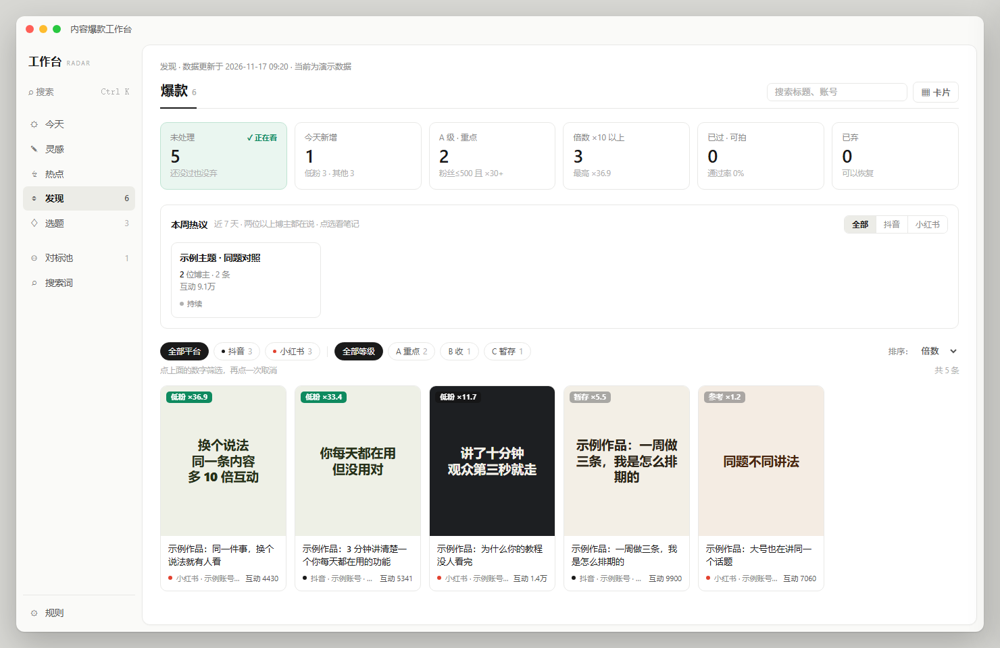
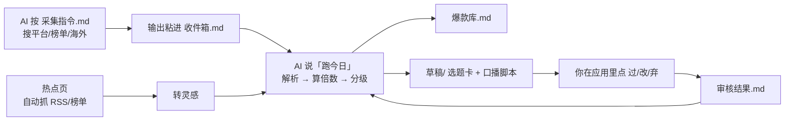

# 低粉爆款雷达 · 内容工作台

一个只干一件事的本地工作台：**采集 → 算倍数 → 分级 → 出选题卡和口播脚本 → 你审**。

它盯的不是「大爆款」，是**粉丝很少、互动很高**的作品——因为那种作品的结构，才搬得动到还在起号的账号上。

---

## 它解决什么

- 收藏了几百条爆款，真要拍的时候一条都用不上
- 看得出「这条火了」，看不出「为什么火、我怎么讲」
- AI 写的脚本像通稿，因为没人告诉它你的口播习惯
- 审核靠脑子记，弃过的坑下次还踩

工作台把这几件事固定成文件和流程：数据落在 Markdown / JSON 里，哪天不用了也能直接读。

## 30 秒上手（Windows）

1. 克隆或下载本仓库，解压到任意文件夹（路径里有中文没问题）
2. 确认有 **WebView2 Runtime**（Win11 自带；Win10 一般随 Edge 装好，没有就装微软官方运行时）
3. 双击 `app\build.cmd` 编译。它用系统自带的 .NET Framework 4.8 编译器，不用装 Visual Studio
4. 根目录会生成 `<配置.js 里的 name>.exe`，双击打开
5. 打开 `配置.js`，改名字、平台、粉丝/倍数阈值、关键词
6. 打开 `规则.md`，写清你的赛道、要什么不要什么、口播风格
7. 把 `采集指令.md` 里的【】填掉，粘给豆包（或任意带内置浏览器的 AI），建两个每天早上的定时任务
8. 采集结果整段粘进 `收件箱.md`，对 AI 说「跑今日」

> 工作台本身**不调用任何大模型**。采集和出稿由你手头的 AI（豆包、Claude、ChatGPT……）完成；工作台负责把流程、数据、审核固定下来，别让每次从零开始。

## 它怎么跑

取舍是刻意的：**采集、判断、出稿交给 AI；留哪条、怎么讲、拍不拍，留给人。**

## 界面

| 页 | 干什么 |
|---|---|
| 今天 | 等你审的、已过待拍的、新灵感和新热点 |
| 灵感 | 任何页面 `Ctrl+I` 记一条，可转选题 |
| 热点 | 抓开发者/行业在聊、你主平台还没人讲的（需要桌面应用） |
| 发现 | 全部作品，按等级/平台/倍数筛，点开看选题卡和脚本 |
| 选题 | 已经出了卡的选题，按审核状态过 |
| 对标池 | 同一账号上榜 ≥ 2 次自动入池 |
| 搜索词 | 你配置的关键词，各自命中多少条 |
| 规则 | 分级阈值和当前条数 |

## 文件表

| 文件 | 谁写 | 说明 |
|---|---|---|
| `配置.js` | 你 | 名称、平台、阈值、关键词、热点源。**只改这一份** |
| `规则.md` | 你 + AI | 赛道、白名单、口播风格、弃稿沉淀。改阈值要和 `配置.js` 同步 |
| `采集指令.md` | 你 + AI | 粘给 AI 的采集提示词模板，填【】即可 |
| `收件箱.md` | 你粘，AI 清空 | 原始采集结果的落脚点 |
| `爆款库.md` | AI | 带来源链接的入库记录 |
| `草稿/` | AI 出，你审 | 选题卡 + 完整口播脚本，`_模板.md` 是格式 |
| `数据.js` | AI 重写 | 界面数据。演示数据带 `demo: true` |
| `审核结果.md` | 应用自动写 | 你每次点过/改/弃都会更新 |
| `灵感.json` / `灵感.md` | 应用自动写 | json 是数据本体，md 是给 AI 读的版本 |
| `热点.json` | 应用自动抓 | 热点页数据 |
| `热点词.txt` | 你 | 热点页留哪些条目，语法见文件开头 |
| `素材/封面/<笔记ID>.jpg` | 你/AI | 原帖封面，没有就显示色块 |
| `app/` | 源码 | `src/Program.cs` 是壳，改完双击 `app/build.cmd` 重编译 |

## 配置怎么改

打开 `配置.js`，字段都在注释里写了。几个关键项：

| 字段 | 作用 |
|---|---|
| `name` / `shortName` / `subtitle` | 窗口标题和左上角品牌 |
| `platforms` | 你做的平台，`id` 要和 `数据.js` 里每条作品的 `pf` 对上 |
| `primaryPlatform` | 主平台，用来标「这个平台还没人做」 |
| `grading` | A/B/C 档的粉丝和倍数阈值；改完记得同步 `规则.md` |
| `account.fans` | 你自己的粉丝数，显示在规则页 |
| `keywords` | 搜索词，列在「搜索词」页 |
| `feeds` | 热点源。newsnow 源只填 id/name/domain；RSS 源再填 url 和 `rss: true` |

改完：**桌面应用关掉重开**（配置只在启动时读一次），浏览器里刷新页面。

## 换赛道三步

1. `配置.js`：`platforms` 留下你在做的平台，`keywords` 换成你赛道的词，`grading` 按你的体量调
2. `规则.md`：写清「要什么 / 不要什么」，口播风格那节填掉（不填，AI 只能写通稿）
3. `采集指令.md`：把【赛道】【要什么】【不要什么】【平台】【关键词】【封面目录】填掉，粘给 AI

热点源不搭就删：`配置.js` 的 `feeds` 默认是科技类，做美食、母婴、家居就换成你行业的 RSS（GitHub 上搜 "site rss feed" 一般都能找到）。

## 常见问题

**打开提示 WebView2 启动失败**
装 Microsoft Edge WebView2 Runtime（Evergreen 版）。Win11 一般自带。

**热点页一直空**
先看 `热点词.txt` 有没有启用词（现在是注释状态，故意留空的）。再看应用里各源的状态行，`✗` 后面就是原因。

**封面图不显示**
文件名必须是链接里的笔记 ID，放 `素材/封面/`，扩展名 jpg / png / webp 都行。没有图会退回色块，不影响用。

**改了 `数据.js`，窗口没刷新**
应用会监听 `数据.js` 自动刷新；如果没动，确认文件保存成功了。

**能出 App 或 Mac 版吗**
壳是 WinForms + WebView2，只在 Windows。`工作台.html` 也能直接用浏览器打开，但热点抓取、写文件这些功能要桌面应用。

**换名字后 exe 没变**
exe 名字跟 `配置.js` 的 `name` 走，改完要重新编译。

## 技术栈

- 壳：C# WinForms + WebView2，约 500 行，只做四件事：开窗口、替页面写文件、监听 `数据.js` 自动刷新、跨域抓热点
- 界面：单个 `工作台.html`，原生 JS + CSS，无依赖、无打包
- 数据：Markdown + JSON，人可直接读写
- 构建：系统自带 `csc`（.NET Framework 4.8），无 NuGet、无工程文件

## 隐私

- 所有数据都在本地文件夹，不上传
- 唯一的外部请求是「热点」页抓 RSS / newsnow 榜单
- `素材/封面/` 里是别人作品的封面图，只作参考；要二创请自己拍或自己画，别直接搬

## 许可

MIT，见 [LICENSE](LICENSE)。

第三方：

- `app/lib/` 下的 WebView2 DLL 来自 Microsoft WebView2 SDK，按其许可随本应用分发
- 热点关键词语法参考 [TrendRadar](https://github.com/sansan0/TrendRadar)，newsnow 聚合接口归其作者所有

## 致谢

给所有还在起号期、愿意把「为什么火」想明白的人。
